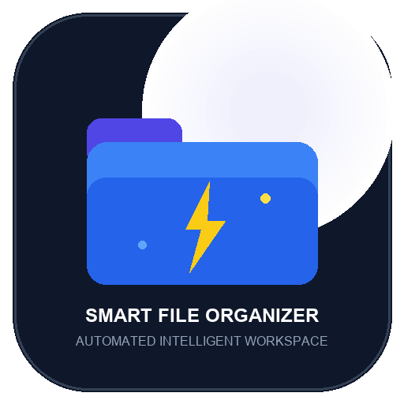
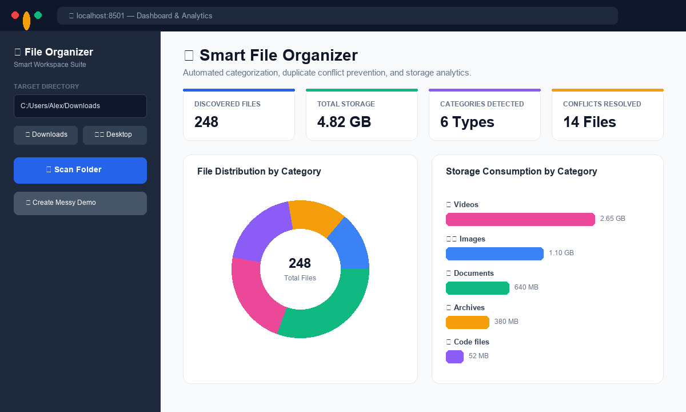
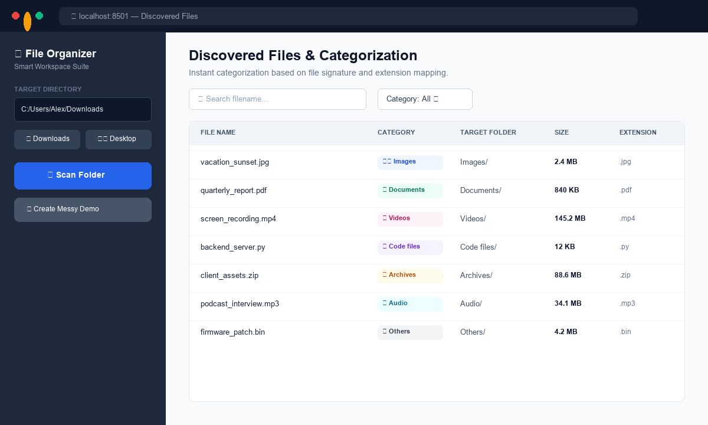
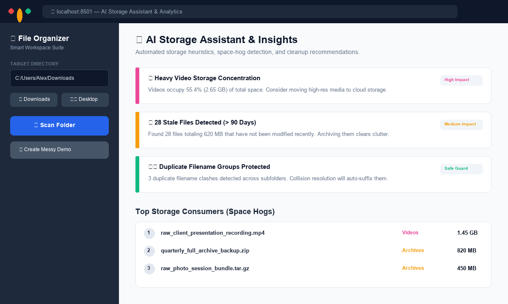
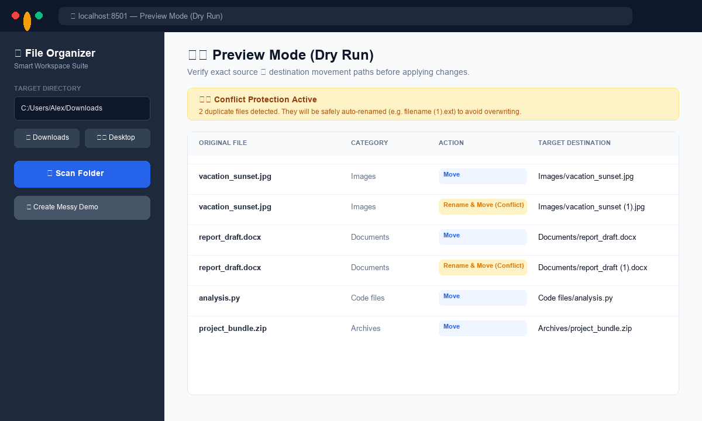
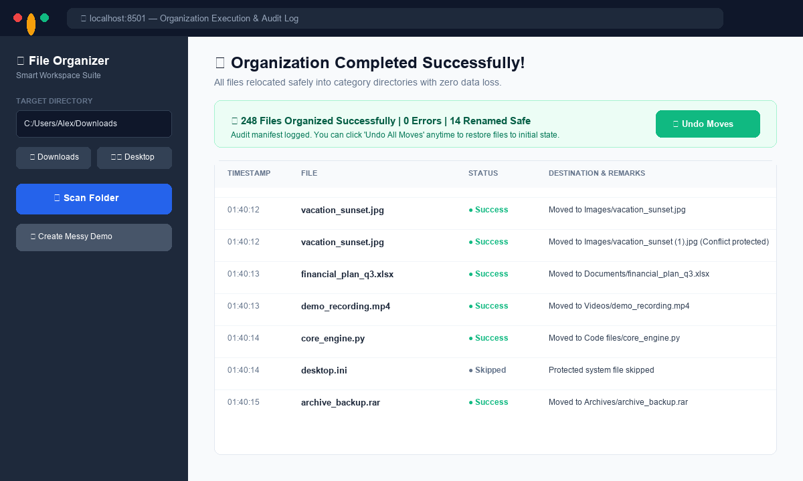

<p align="center">
  
</p>

<h1 align="center">Smart File Organizer</h1>

<p align="center">
  <b>A modern, enterprise-grade desktop & web tool that automatically scans, categorizes, previews, and organizes messy folders with Plotly analytics, duplicate collision protection, one-click undo rollback, and an AI Storage Assistant.</b>
</p>

<p align="center">
  
  
  
  
  
  
</p>

---

## 📖 Overview

### The Problem
Most users accumulate hundreds or thousands of miscellaneous files in their `Downloads`, `Desktop`, and project folders. Traditional manual sorting is time-consuming, tedious, and prone to catastrophic mistakes—such as accidentally overwriting an older invoice or photo with an identical filename.

### The Solution
**Smart File Organizer** turns chaotic folders into clean, well-structured directories in seconds. Built with **Streamlit**, **pathlib**, **Plotly**, and an **AI Storage Assistant**, it offers:
- Automated categorization across Images, Documents, Videos, Code files, Archives, and Audio.
- Zero-risk **Dry-Run Preview** so you can inspect planned movements before touching a single byte on disk.
- **Duplicate Collision Protection** that automatically appends incremental suffixes (`document (1).pdf`) instead of overwriting existing data.
- **One-Click Undo Engine** that completely reverses organization runs and prunes empty directories.

### Why This Project Exists
Existing file sorters are either brittle CLI scripts with no safety nets, or bloated closed-source tools that require sending metadata to external servers. Smart File Organizer is **100% local, private, visual, and non-destructive**.

---

## ✨ Features

- **🚀 Automated File Organization:** Automatically creates target category folders and safely moves discovered files.
- **🏷️ Smart Categorization:** Detects file types by signature and extension:
  - 🖼️ **Images:** `.jpg`, `.png`, `.jpeg`, `.gif`, `.webp`, `.svg`, `.bmp`, `.tiff`, `.ico`
  - 🎬 **Videos:** `.mp4`, `.mkv`, `.avi`, `.mov`, `.wmv`, `.flv`, `.webm`
  - 📄 **Documents:** `.pdf`, `.docx`, `.txt`, `.xlsx`, `.pptx`, `.csv`, `.md`, `.epub`
  - 💻 **Code files:** `.py`, `.js`, `.ts`, `.html`, `.css`, `.java`, `.cpp`, `.c`, `.sql`, `.json`
  - 📦 **Archives:** `.zip`, `.rar`, `.7z`, `.tar`, `.gz`, `.bz2`
  - 🎵 **Audio:** `.mp3`, `.wav`, `.flac`, `.aac`, `.ogg`, `.m4a`
  - 📁 **Others:** Safe fallback for uncommon or custom binary formats
- **👁️ Safe Preview Mode (Dry Run):** Interactive preview table inspecting exact Source ➔ Destination paths with zero disk writes.
- **🛡️ Duplicate Collision Handling:** Automatic conflict avoidance prevents accidental data loss when files share duplicate names across folders.
- **⏪ One-Click Undo Rollback:** Reverses all moves performed during a session and prunes empty category folders.
- **📊 Interactive Analytics Dashboard:** Responsive Plotly Donut and Horizontal Bar charts visualizing file counts and storage consumption (MB/GB).
- **🧠 AI Storage Assistant:** Heuristic intelligence identifying top space hogs, stale files (>90 days old), and actionable cleanup opportunities.
- **🧪 1-Click Sandbox Environment:** Instantly generates a realistic messy folder structure for testing without risking personal files.
- **⚙️ Custom Extension Rules:** Dynamically customize extensions and target folder names directly from the UI.

---

## 📸 Screenshots

### 1. Main Dashboard & Storage Metrics


### 2. Discovered Files & Real-time Categorization Table


### 3. AI Storage Assistant & Interactive Analytics


### 4. Preview Mode (Dry Run) & Conflict Alerts


### 5. Execution Results, Audit Log, and One-Click Undo


---

## 🛠️ Tech Stack

| Technology | Purpose |
|---|---|
| **Python 3.10+** | Core programming language (tested on Python 3.13) |
| **Streamlit** | Modern, responsive SaaS-style web interface |
| **Plotly** | Interactive vector charts (Donut, Bar, Grouped Comparisons) |
| **Pandas** | High-performance tabular data filtering, searching, and CSV export |
| **pathlib & os** | Safe, cross-platform filesystem operations and path resolution |
| **Pytest** | Automated unit and integration testing suite |
| **Pillow (PIL)** | Brand asset rendering and image processing |

---

## ⚡ Installation

### 1. Clone the Repository
```bash
git clone https://github.com/syedaqdas/smart-file-organizer.git
cd smart-file-organizer
```

### 2. Set Up a Virtual Environment (Recommended)
```bash
# On Windows
python -m venv .venv
.venv\Scripts\activate

# On macOS / Linux
python3 -m venv .venv
source .venv/bin/activate
```

### 3. Install Dependencies
```bash
pip install -r requirements.txt
```

### 4. Run the Application
```bash
streamlit run app.py
```

The web dashboard will launch at `http://localhost:8501`.

---

## 🎯 Usage Guide


1. **Select a Target Directory:**
   - Enter an absolute folder path in the sidebar, or click a quick shortcut (**Downloads**, **Desktop**, **Documents**).
   - Alternatively, click **"✨ Create Messy Demo Folder"** to generate an isolated testing sandbox.
2. **Scan the Folder:**
   - Configure options: toggle **Recursive Subfolder Scanning** or **Skip Hidden Files**.
   - Click **"🔍 Scan Directory"**.
3. **Inspect Analytics & AI Recommendations:**
   - Navigate to the **Scan & Analytics** tab to see Plotly distribution charts and the file search table.
   - Switch to **AI Storage Assistant** to review space hogs, stale assets, and storage optimization tips.
4. **Preview the Move Plan (Dry Run):**
   - Click the **Preview (Dry Run)** tab to inspect all intended file relocations and collision warnings.
5. **Organize Files Safely:**
   - Go to the **Organize Files** tab and click **"🚀 Start Organizing Now"**.
   - Watch the animated progress bar as files are moved and audit logs are recorded.
6. **Rollback if Needed:**
   - Changed your mind? Visit the **Undo & Rollback** tab and click **"⏪ Undo All Moves"** to return all files to their initial state.

---

## 🏛️ Project Architecture

```
Smart-File-Organizer/
│
├── app.py                      # Main Streamlit web application & SaaS dashboard layout
├── requirements.txt            # Application dependencies
├── README.md                   # Professional project documentation
├── LICENSE                     # MIT open-source license
├── CONTRIBUTING.md             # Contributor guidelines and PR workflow
├── CHANGELOG.md                # Version history adhering to Keep a Changelog
├── .gitignore                  # Git exclusion rules for Python, Streamlit, and OS files
│
├── organizer/                  # Core domain logic
│   ├── __init__.py             # Public package exports
│   ├── categories.py           # File extension mappings, category rules, and color palettes
│   ├── scanner.py              # Directory scanner, metadata extractor, and defensive guards
│   ├── organizer.py            # Move execution engine, collision resolver, & rollback manager
│   ├── assistant.py            # AI Storage Assistant & heuristic optimization engine
│   └── visualizer.py           # Responsive Plotly chart components
│
├── utils/
│   ├── __init__.py
│   ├── demo_data.py            # Sandbox generator with realistic mock messy files
│   └── generate_assets.py      # High-resolution brand logo & screenshot generation script
│
├── tests/
│   ├── __init__.py
│   ├── test_scanner.py         # Unit tests for scanner, file filters, and size formatting
│   ├── test_organizer.py       # Unit tests for dry-run, moves, collision safety, and undo
│   └── test_assistant.py       # Unit tests for the AI Storage Assistant heuristics
│
└── assets/
    ├── logo.png                # High-resolution brand logo (512x512)
    ├── demo/                   # Demo assets directory
    └── screenshots/
        ├── dashboard.png       # Main overview dashboard
        ├── file_scan.png       # Discovered files table
        ├── analytics.png       # Storage charts & AI assistant
        ├── preview_mode.png    # Dry-run preview table & conflict notice
        └── organized_result.png # Execution audit log & undo banner
```

---

## 🧪 Testing

The project includes an automated test suite executed with `pytest`:

```bash
pytest -v
```

### Test Suite Coverage:
- **`tests/test_scanner.py`**: Validates category extension detection, human-readable byte formatting, hidden/system file filtering, and invalid path handling.
- **`tests/test_organizer.py`**: Verifies that Dry-Run mode performs zero disk modifications, confirms live category folder creation, validates duplicate collision renaming (`filename (1).ext`), and verifies full undo restoration with empty directory cleanup.
- **`tests/test_assistant.py`**: Tests AI Storage Assistant heuristics, including space hogs ranking, stale file detection (>90 days), and duplicate name clustering.

```text
============================= test session starts =============================
platform win32 -- Python 3.13.3, pytest-9.1.1, pluggy-1.7.0
rootdir: C:\Users\DELL\OneDrive\Desktop\python project
collected 12 items

tests/test_assistant.py::test_assistant_empty_summary PASSED             [  8%]
tests/test_assistant.py::test_assistant_heavy_media_and_stale_files PASSED [ 16%]
tests/test_assistant.py::test_assistant_duplicate_names PASSED           [ 25%]
tests/test_organizer.py::test_dry_run_does_not_modify_disk PASSED        [ 33%]
tests/test_organizer.py::test_live_execution_organizes_files PASSED      [ 41%]
tests/test_organizer.py::test_collision_resolution PASSED                [ 50%]
tests/test_organizer.py::test_undo_restoration PASSED                    [ 58%]
tests/test_scanner.py::test_category_matching PASSED                     [ 66%]
tests/test_scanner.py::test_format_file_size PASSED                      [ 75%]
tests/test_scanner.py::test_scan_directory_basic PASSED                  [ 83%]
tests/test_scanner.py::test_scan_directory_hidden_files PASSED           [ 91%]
tests/test_scanner.py::test_scan_nonexistent_directory PASSED            [100%]

============================= 12 passed in 0.95s ==============================
```

---

## 🔮 Future Improvements & Roadmap

- [ ] **Cryptographic Hash Duplicate Detection:** SHA-256 byte hashing to detect exact duplicate files regardless of filename.
- [ ] **Cloud Storage Integration:** Connectors for Google Drive, Dropbox, and AWS S3 bucket organization.
- [ ] **LLM Document Categorization:** Local Ollama / HuggingFace model integration to summarize documents and classify by semantic context.
- [ ] **Automated Background Scheduler:** Windows Task Scheduler and cron daemon hooks for recurring folder cleanup.
- [ ] **ZIP Archive Auto-Extraction:** Unpack archives into labeled directories before categorization.

---

## 👨‍💻 Author

Developed by Syed Aqdas Imam, a Computer Science Engineering student at Cambridge Institute of Technology, Bengaluru.
GitHub: @syedaqdas
LinkedIn: linkedin.com/in/syedaqdas
If you found this project helpful, please consider giving it a ⭐ on GitHub!
- Project Repository: [Smart File Organizer](https://github.com/syedaqdas/smart-file-organizer)

---

## 📄 License

This project is licensed under the **MIT License** — see the [LICENSE](LICENSE) file for details.
